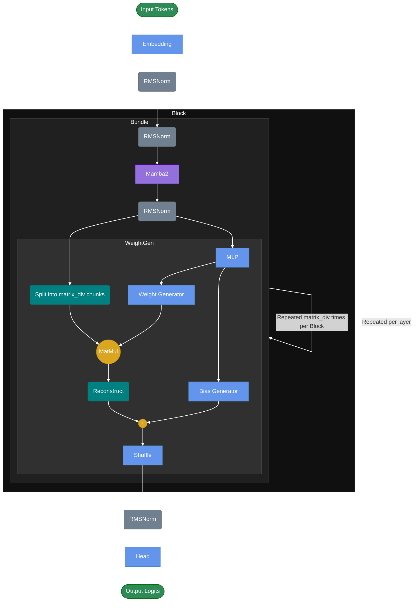

# Puppet-166M

_Puppet_ is a Language Model (LM) that I've been working on for the past few months. It combines [Mamba](https://arxiv.org/abs/2312.00752) with an experimental Stepped Weight Generation architecture.

> **Model definition:** `main.py`

> **Pretrained weights:** [Hugging Face](https://huggingface.co/LatentWraith/Puppet-166M)

Due to compute limitations, I was only able to train the model for ~3.5 billion tokens. While this follows the Chinchilla rule $(20 \cdot P$ where $P$ is the parameter count), it's still a small fraction of the dataset size used to train models such as [GPT-2 Small](https://huggingface.co/openai-community/gpt2) or [Pythia-160M](https://huggingface.co/EleutherAI/pythia-160m).

While I may resume pre-training in the future, `Puppet-166M` currently achieves an _acc_norm_ score of $28.73$% on HellaSwag.

## Architecture

I originally started _Puppet_ as an experiment, aiming to train a functioning Language Model using Weight Generation, without relying on [Attention](https://arxiv.org/abs/1706.03762).

### Base Idea

The idea behind this architecture is to generate transformations specific to the current latent vector, rather than relying on a fixed set of weights. Several existing architectures currently achieve this, typically by selecting between multiple pre-existing sets of parameters. _Puppet_ instead generates a unique weight matrix and bias vector using the latent as the input. This approach is known as [Weight Generation](https://arxiv.org/abs/1609.09106).

Despite the benefits, full Weight Generation is rarely used in modern LLMs, largely due to its substantial parameter cost. To generate a weight matrix for a latent of $D$ dimensions, a $D \times D^2$ matrix is needed, taking $D^3$ parameters for that layer alone (plus $D^2$ for the bias). This rapidly increasing parameter count limits the number of context-mixing modules that can be feasibly included in the model.

### Previous Models

My previous iteration of _Puppet_ used this full Weight Generation approach, exposing some of its practical limitations. Training suffered from a stalled validation loss of approximately $3.69$ nats, and I noticed weak context retention during evaluation.

### Puppet-166M

To solve these issues, I staggered Weight Generation in `Puppet-166M`. Each `Block` contains multiple `Bundle` classes, each containing, in order: a Mamba2 module, Weight Generator, and shuffle matrix.

The Weight Generator only generates a fraction of the full $D^2$ weight matrix, controlled by `matrix_div` $(D_m)$. The latent vector is split into $D_m$ sections, each multiplied by a corresponding $\left(\frac{D}{D_m}\right)\times\left(\frac{D}{D_m}\right)$ matrix generated by the Weight Generator. The latent is then reconstructed and multiplied by the shuffle matrix.

This is equivalent to multiplying the latent by a matrix containing dense blocks along its diagonal. The shuffle matrix allows information from different sections of the latent to interact with every other section across sequential transforms, fixing the main flaw of smaller independent dense blocks.

By staggering Weight Generation, the parameter cost is distributed across multiple smaller generators, allowing me to interleave more context-mixing Mamba2 modules between the sequential transforms, whilst still retaining a fully generated $D \times D$ matrix transformation.

## Training

I trained `Puppet-166M` for approximately 3.5 billion tokens over the course of a month (intermittently), from random initialisation to a validation loss of $3.425$ nats and a HellaSwag score of $28.73$%.

Training was highly inefficient, as this was my first converged model. I varied the effective batch size several times before settling on $524,288$ tokens for the majority of the run. For the learning rate, I kept it at $1e-4$ for the majority of the run before lowering it linearly at the end (WSD schedule). The optimiser I used was AdamW with betas of $(0.9, 0.95)$.

One of the main flaws during training was likely the dataset choice. I used several shards from the $2018$ section of FineWeb, leading to temporal bias which a distribution sampled from multiple years (or the 10B subset of FineWeb) would have reduced. The dataset consisted of around $5$ billion tokens, of which only ~ $3.5$ billion were seen by the model (sampled randomly).

> Training lasted $14,000$ optimiser steps

## Benchmarks

`Puppet-166M` achieves a HellaSwag score of $28.73$%. Despite its larger parameter count, it still falls behind similarly sized models like `Pythia-160M` and `GPT-2 Small`. Here is a comparison of how `Puppet-166M` performs against these mainstream models, along with their parameter counts and training tokens.

|Model|HellaSwag|PIQA|WinoGrande|Arc Easy|Parameters|Training Tokens|
|:---:|:---:|:---:|:---:|:---:|:---:|:---:|
|`Puppet-166M`| $28.73$% | $61.04$%| $51.22$%| $34.18$%| $166\times 10^6$| $3.5\times 10^9$|
|`Pythia-160M`| $31.40$% | $61.64$%| $53.12$%| $39.65$%| $160\times 10^6$| $300\times 10^9$|
|`GPT-2 Small`| $31.14$% | $62.51$%| $51.62$%| $39.48$%| $124\times 10^6$| $10\times 10^9$|

> Accuracy shown as `acc_norm` where available, otherwise `acc`

## Final Thoughts

`Puppet-166M` was an experiment to test whether an unconventional architecture (Weight Generation + Mamba2) could compete with, or even outperform, similarly sized models. Despite falling behind smaller models in multiple benchmarks, `Puppet-166M` remained within $1–2$ percentage points of the mainstream models in some tests, with the largest difference being $5.47$ percentage points in `Arc Easy`. For my first converged (and my largest trained) model, I would not consider this a failure.

I may continue training in the future, or develop a revised variant. Were I to retrain, these would be the main issues I would address:

- Use a more evenly distributed FineWeb sample rather than shards from a single year
- Train for much longer – at least ~ $10$ billion tokens
- Use a consistent WSD training schedule
- Improve context mixing, either through more Mamba layers or an adapted variant

## Licence

This project is licensed under the MIT License
